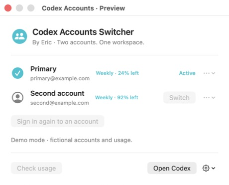
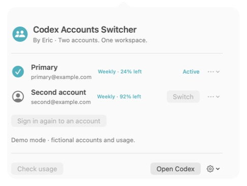

# Codex Accounts Switcher

**By Eric.** A native macOS menu-bar app to switch between two saved Codex accounts and see their usage side by side.



## Features

- Save two ChatGPT account logins in macOS Keychain.
- Check each account's usage without switching accounts.
- Switch accounts manually and reopen Codex.
- Keep the existing local Codex home, project files, and task history.
- Use a compact popup that fits its content and scrolls on smaller screens.
- Recover the previous login if a switch is interrupted.

No third-party libraries, analytics, proxy, or automatic account rotation.

## Requirements

- Apple Silicon Mac with macOS 14 or later.
- The official Codex desktop app, with a ChatGPT account signed in.
- Xcode Command Line Tools to compile the app (`xcode-select --install`).

This is an independent community project, not an OpenAI product. Each account needs its own Codex access. Use accounts you are authorized to access.

## Install from source

```sh
git clone https://github.com/neddes/codex-accounts-switcher.git
cd codex-accounts-switcher
./build.sh
unzip CodexAccountsSwitcher.zip
```

Move **Codex Accounts Switcher.app** to Applications and open it. The script typechecks and compiles the source, then applies and verifies an ad-hoc signature. It does not use Developer ID signing or notarization. macOS can require approval to open a locally compiled app. Recompiling can also cause Keychain to request access again.

## Add your accounts

1. Open the menu-bar app and select **Save current account**.
2. Select **Add second account**.
3. Copy the displayed code and select **Open OpenAI sign-in**.
4. Sign in with your second account. If requested, enable **Device code authorization for Codex** in that account's ChatGPT security settings, cancel the old attempt, and start again for a new code.
5. Select **Check usage** to refresh both rows. Hover over a usage value to see its reset time when available.

You do not need to sign out of your current Codex account to add the second account. You can rename or remove a saved login from its row menu.

## Switch accounts

Finish active tasks first, including CLI, IDE, and scheduled work. Select **Switch**, then confirm **Switch and reopen**. The app asks Codex to close, waits for its processes to exit, saves the latest current login, replaces the active login, and reopens Codex. It does not force-quit Codex.

The app retains the existing local conversation database, sessions, projects, worktrees, skills, and configuration. It changes the active `~/.codex/auth.json`. Cloud conversations, workspace access, and connected services remain account-specific. Continuing an existing task uses the selected account for subsequent requests.

## Privacy and credential handling

- Saved logins and the recovery record live in macOS Keychain. No credentials are included in this repository.
- The active Codex login file is replaced atomically with owner-only permissions. The app checks for concurrent changes and refuses unsupported credential stores, symlinked auth files, and forced account policies.
- Adding an account uses the official bundled Codex CLI in a separate private temporary home. The temporary folder is removed on normal completion or cancellation; a crash can leave a folder behind.
- The app saves refreshed credentials for an already-saved active account every 60 seconds using local files. It does not renew OAuth tokens itself.
- Usage checks send each saved account's access token directly to OpenAI at `https://chatgpt.com/backend-api/wham/usage`. Redirects are refused. This is an undocumented endpoint and can change.
- A failed usage check shows **Usage unavailable**. Use **Sign in again to an account** if the saved login needs renewal.
- No passwords, tokens, or raw CLI output are logged by the app.

The Keychain service remains `local.eric.CodexAccounts.v1` for compatibility with the original app. The local support folder is `~/Library/Application Support/Codex Accounts/`.

## Screenshots

Screenshots show the actual SwiftUI interface in demo mode. All emails, accounts, and usage values are fictional.



## Development and tests

```sh
xcrun swiftc -swift-version 5 -typecheck Source/Core.swift Source/App.swift Source/Launcher.swift
xcrun swiftc -swift-version 5 Source/Core.swift Source/Tests.swift -o /tmp/codex-accounts-tests
/tmp/codex-accounts-tests
# Optional: isolated Keychain test with fake credentials
/tmp/codex-accounts-tests --keychain
```

Tests cover identity parsing, usage parsing, ANSI device codes, atomic writes, file permissions, concurrent changes, recovery, history preservation, symlink refusal, and process locks.

To inspect the app without reading real credentials, run the compiled executable with `--preview`. Add `--preview-popup` to show the menu-bar popup instead of the preview window. Preview mode uses fictional accounts, skips the vault, and disables account mutations. Do not run two normal app instances together.

## Limitations

This app depends on the current Codex file-login format and bundled CLI. Future Codex changes can require updates. Local file checks do not prove that every account-specific cloud feature will work after a switch. This project has not had an independent security audit.

## Remove

Use each account's row menu to remove saved logins if desired, then quit the app and remove it from Applications. An empty vault can remain in Keychain under **Codex Accounts saved logins**. Removing the switcher does not remove Codex tasks or sign out the active Codex account.

## License

[MIT](LICENSE) — Copyright (c) 2026 Eric.
